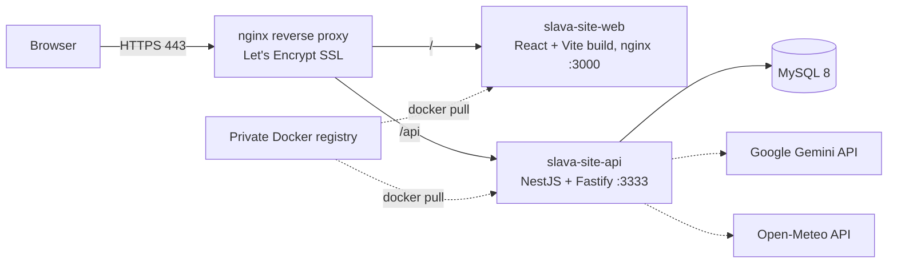

# slava-site-infra — infrastructure of slava-kvet.com

How my portfolio site ran in production (Nov – Dec 2025): one small Linux VPS (about $4/month) instead of
managed cloud services. Everything is plain Docker Compose and nginx, built and operated by me.

## Architecture



## What's here

| Path | Purpose |
|---|---|
| `docker-compose-production.yml` | Production stack: MySQL 8, API (port 3333), web (port 3000), shared bridge network, persistent MySQL volume |
| `docker-compose.yml` | Same stack for building locally |
| `reverse-proxy/reverse-proxy.conf` | nginx on the host: HTTP → HTTPS redirect, Let's Encrypt certificates, `/` → web, `/api` → API |
| `docker-registry/` | Private Docker registry (basic auth) behind its own nginx, so images are pushed from my PC and pulled on the server |
| `mysql/migration/init.sql` | Database schema + **demo data only** (fake users), loaded on first start |
| `scripts/` | Build / tag / push / redeploy commands for frontend and backend |
| `coming-soon-page.html` | Static page served while the app was being deployed |

## Deployment flow

1. Build the frontend and backend images on my PC (`docker build`), tag them for the private registry, `docker push`.
2. On the server: `docker compose -f docker-compose-production.yml pull && up -d`.
3. nginx terminates SSL and routes traffic to the containers.

Secrets (`.env` files, registry password, certificates) were kept only on the server and are not in this repo;
see `mysql/.env.example`.

## Run the whole stack locally

```bash
# clone the three repos side by side, then build the two images:
(cd ../slava-site-api && docker build -t backend .)
(cd ../slava-site-web && docker build -t frontend .)

cp mysql/.env.example mysql/.env
mkdir -p backend && cp ../slava-site-api/.env.example backend/.env   # point TYPEORM_HOST at mysql_db
docker compose up -d
# web: http://localhost:3000   API: http://localhost:3333   Swagger: http://localhost:3333/docs
```

## Related repositories

| Repo | What it is |
|---|---|
| [slava-site-web](https://github.com/israelrider/slava-site-web) | Frontend: React + TypeScript |
| [slava-site-api](https://github.com/israelrider/slava-site-api) | Backend: NestJS REST API |
| [slava-site-infra](https://github.com/israelrider/slava-site-infra) | Infrastructure: Docker Compose, nginx, registry, MySQL |

---

## Operations notes (original)

`docker stop frontend backend mysql_db; docker rm frontend backend mysql_db; docker rmi docker-frontend docker-backend; docker compose up -d --build --remove-orphans;`

`docker build -t frontend .`
`docker build -t backend .`
`docker-compose down; docker compose up -d --build --remove-orphans;`

`docker compose logs;`

-f, --force: Bypasses the confirmation prompt.

`docker image prune -f`

`docker system prune`